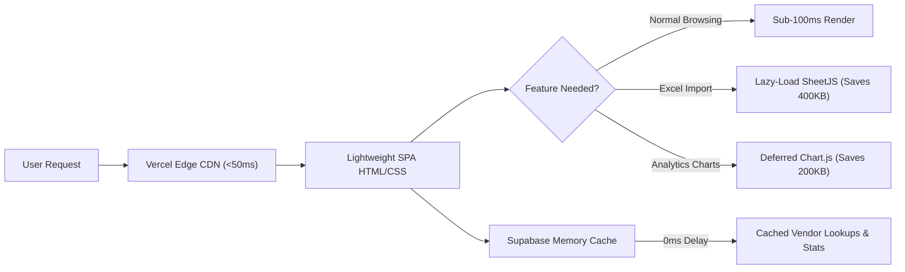

<div align="center">

# 🔥 Shiv Shakti HP Gas Agency
### Enterprise Cloud CRM, Delivery Logistics & Complaint Management Portal

[](https://sshpcomp.vercel.app)
[](https://supabase.com)
[](https://sshpcomp.vercel.app)
[](LICENSE)

<br/>

**Shiv Shakti HP Gas Agency CRM** is a high-performance, mobile-first cloud application built for LPG gas agencies to streamline end-to-end customer complaint management, automated delivery boy dispatching, thermal receipt printing, route optimization, and live consumer analytics.

[🌐 Launch Live Application](https://sshpcomp.vercel.app) • [📖 Key Features](#-key-features) • [🚚 Delivery Console](#-delivery-boy-console) • [🖨️ Thermal Printing](#-thermal-printer-support) • [⚡ Architecture](#-architecture--tech-stack)

---

</div>

## 📑 Table of Contents
- [🌟 Key Highlights](#-key-highlights)
- [🚀 Comprehensive Features](#-comprehensive-features)
  - [👑 Administrator & Management Console](#1-administrator--management-console)
  - [🚚 Delivery Boy / Vendor Mobile Console](#2-delivery-boy--vendor-mobile-console)
  - [🖨️ Portable Thermal Receipt Printing](#3-portable-thermal-receipt-printing)
  - [🗺️ GPS Route Optimizer & WhatsApp Dispatch](#4-gps-route-optimizer--whatsapp-dispatch)
  - [🔐 Password Recovery & Role-Based Access](#5-password-recovery--role-based-access)
- [⚡ Performance & Speed Optimizations](#-performance--speed-optimizations)
- [🛠️ Architecture & Tech Stack](#-architecture--tech-stack)
- [🗄️ Database Schema (Supabase)](#-database-schema-supabase)
- [💻 Local Development & Deployment](#-local-development--deployment)
- [👥 User Roles & Access Guidelines](#-user-roles--access-guidelines)

---

## 🌟 Key Highlights

| Feature | Description |
| :--- | :--- |
| **⚡ Edge Hosted** | Instant global loading via Vercel Edge Network CDN (<50ms initial paint) |
| **☁️ Supabase Cloud DB** | Real-time PostgreSQL cloud database with zero local server overhead |
| **📱 Mobile PWA Ready** | Responsive UI tailored for delivery boys on Android/iOS smartphones |
| **✍️ Proof of Delivery** | Built-in touch screen Signature Pad, OTP verification, and Photo capture |
| **🖨️ Thermal Receipts** | 1-click printing scaled for **A4**, **80mm (3-inch)**, and **58mm (2-inch)** Bluetooth printers |
| **🗺️ Route Optimizer** | Auto-calculated Google Maps GPS delivery routing for pending deliveries |
| **💬 WhatsApp Connect** | 1-tap pre-filled WhatsApp customer chat & delivery notifications |

---

## 🚀 Comprehensive Features

### 1. 👑 Administrator & Management Console
* **Interactive Live KPI Cards:** Real-time counters for Total Complaints, Pending Cases, In Progress, Delivered/Resolved, and Today's New Registrations.
* **Full Complaint Lifecycle:** Register, triage, assign vendor, update delivery notes, and close cases.
* **Re-Open Closed Cases:** Secure manager/admin-only permission to re-open resolved cases with audit logging.
* **Staff & Employee RBAC:** Add, toggle active/inactive status, and configure granular permissions (`complaints_view`, `complaints_add`, `edit`, `delete`, `settings`).
* **Impersonation Mode:** Test and view the exact delivery interface of any vendor/delivery boy with a 1-click "Switch Back to Admin" floating banner.
* **Bulk Dispatch & Reassignment:** Batch assign dozens of complaints to specific delivery agents or mark bulk deliveries in seconds.
* **Excel / CSV Consumer Registry:** High-speed bulk drag-and-drop import and export for consumer registries (SBC, DBC, SV, E-KYC status).

---

### 2. 🚚 Delivery Boy / Vendor Mobile Console
* **Distraction-Free Field Layout:** Compact cards displaying Consumer Name, Mobile, LPG Account No, Address, and Complaint Details.
* **1-Tap Quick Actions:**
  * 📞 Direct Phone Call
  * 💬 WhatsApp Chat with pre-filled greeting & delivery reference
  * 📍 Google Maps Navigation directly to the consumer's address
* **Digital Proof of Delivery (POD) Modal:**
  * 🖊️ Interactive HTML5 Canvas signature pad for customer sign-off
  * 🔑 OTP Verification
  * 📷 Camera photo capture of delivered cylinder/seal
* **Dedicated Vendor Mobile Navigation:** Bottom navigation bar featuring *Deliveries*, *History*, *Trip Sheet*, and *More Options* (Password Change & Logout).

---

### 3. 🖨️ Portable Thermal Receipt Printing
* Built-in multi-format printer engine with clean CSS print media queries:
  * 📄 **Standard A4** format for formal office archival records
  * 🧾 **80mm (3-inch)** format for standard counter receipt printers
  * 📱 **58mm (2-inch)** ultra-compact format for handheld Bluetooth thermal printers
* High-contrast monochrome layout rendering Agency Branding, HP Gas Header, Consumer Credentials, Complaint Details, and Vendor Verification box.

---

### 4. 🗺️ GPS Route Optimizer & WhatsApp Dispatch
* **Automated Waypoint Planner:** Extracts all open deliveries and generates an optimized multi-stop Google Maps navigation URL for the delivery agent.
* **Dynamic Template Messaging:** Broadcast pre-formatted WhatsApp job sheets to vendors with 1-click dispatch.

---

### 5. 🔐 Password Recovery & Role-Based Access
* **Self-Service Forgot Password:**
  * Enter registered 10-digit mobile number or username.
  * Instant automatic account discovery across staff and vendor directories.
  * Vendor direct password reset; Admin master PIN protection (`1234` / agency mobile).
* **Direct Admin WhatsApp Help:** 1-tap recovery hotline link to agency administration in case field agents forget their registered numbers.
* **Session Security:** Passwords hashed with standard **SHA-256** prior to database persistence.

---

## ⚡ Performance & Speed Optimizations

The application is tuned for maximum speed even on 2G/3G mobile networks:



1. **Lazy Loading of Heavy Libraries:** SheetJS (`xlsx.full.min.js`, ~400 KB) is loaded strictly on-demand when importing Excel files, saving ~50% initial load time.
2. **Deferred Background Loading:** Chart.js is deferred to allow initial DOM and mobile views to render immediately.
3. **In-Memory Query Caching:** Vendor lookup round-trips and global complaint statistics are cached in-memory with automatic mutation invalidation, cutting database latency to 0ms on tab switches.
4. **W3C Accessibility Compliant:** Proper `inert` DOM states and active element focus blurring to eliminate `aria-hidden` warnings.

---

## 🛠️ Architecture & Tech Stack

| Layer | Technologies Used |
| :--- | :--- |
| **Frontend Framework** | Pure Vanilla JavaScript (ES6+), HTML5 Canvas, CSS3 Custom Properties |
| **UI Components** | SweetAlert2, FontAwesome 6, Plus Jakarta Sans Web Font |
| **Charting & Reports** | Chart.js (Deferred) |
| **File Processing** | SheetJS (On-Demand Asynchronous Import) |
| **Backend & API** | Client-Side Supabase Adapter Bridge (`js/supabase-adapter.js`) |
| **Database** | Supabase Cloud Database (PostgreSQL Engine) |
| **Hosting & CI/CD** | Vercel Serverless Edge Platform |

---

## 🗄️ Database Schema (Supabase)

The core relational database tables configured on Supabase:

* `gas_complaints`: Primary complaint registry (consumer info, status, priority, delivery agent, proof of delivery notes, resolution timestamp).
* `gas_users`: Staff and delivery agent authentication credentials, permissions, and roles (`Admin`, `Manager`, `Vendor`, `Employee`).
* `gas_vendors`: Delivery boys directory (mobile numbers, vehicle/route codes, active workloads).
* `gas_branches`: Multi-branch agency context configurations (HP, Indane, Bharat).
* `gas_settings`: Agency contact info, WhatsApp dispatch templates, company logo, and addresses.
* `gas_consumers`: Registry of registered LPG consumers (SV No, Consumer ID, SBC/DBC, Address).

---

## 💻 Local Development & Deployment

### Quick Local Preview
Because the app is fully static and powered by Supabase Cloud, no local database or PHP installation is required:

1. **Clone the repository:**
   ```bash
   git clone https://github.com/rahulmaithili/complaint-register-.git
   cd complaint-register-
   ```

2. **Serve with any local web server:**
   ```bash
   # Using Python 3:
   python -m http.server 8000

   # Or using Node.js npx:
   npx serve .
   ```

3. **Open in Browser:**
   ```
   http://localhost:8000
   ```

### Deploy to Vercel
Push your repository to GitHub, link it in the [Vercel Dashboard](https://vercel.com), and deploy instantly without any custom build command.

---

## 👥 User Roles & Access Guidelines

| Role | Default Access Scope | Typical Users |
| :--- | :--- | :--- |
| **👑 Admin** | Unrestricted access across all branches, settings, employee management, and reports | Agency Owner & Senior Managers |
| **🚚 Vendor / Delivery Boy** | Filtered mobile console displaying only their assigned complaints, GPS routing & POD capture | Delivery Personnel & Field Technicians |
| **👔 Employee** | Granular branch-restricted complaints entry and lookup | Office Booking Clerks & Receptionists |

---

<div align="center">

**Shiv Shakti HP Gas Agency** • Authorized HP Gas Distributor  
*Pandaul Bazar, Madhubani, Bihar - 847234*  
Technical Inquiries: `+91 7564948617` • Email: `life.rahulg@gmail.com`

</div>
